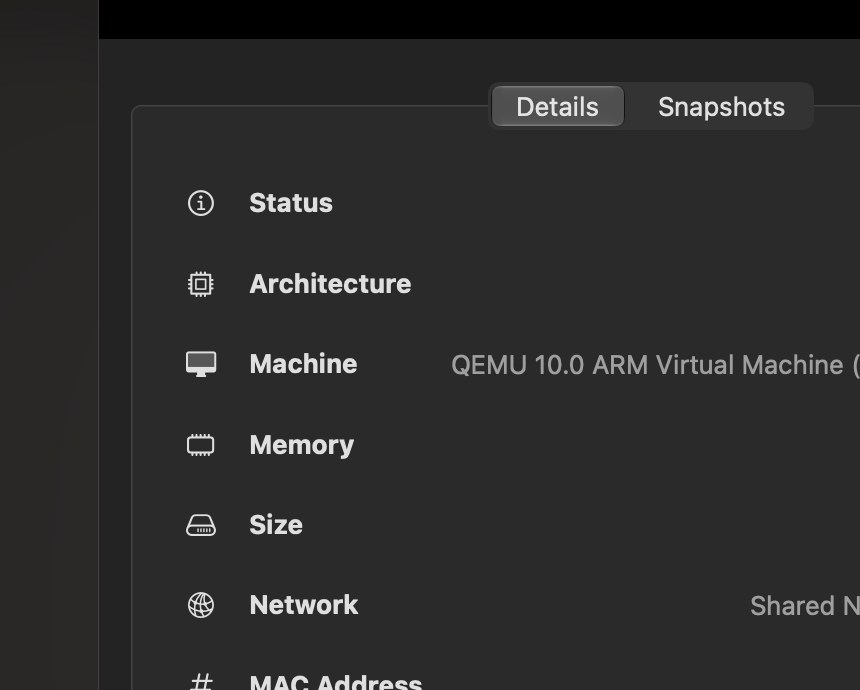
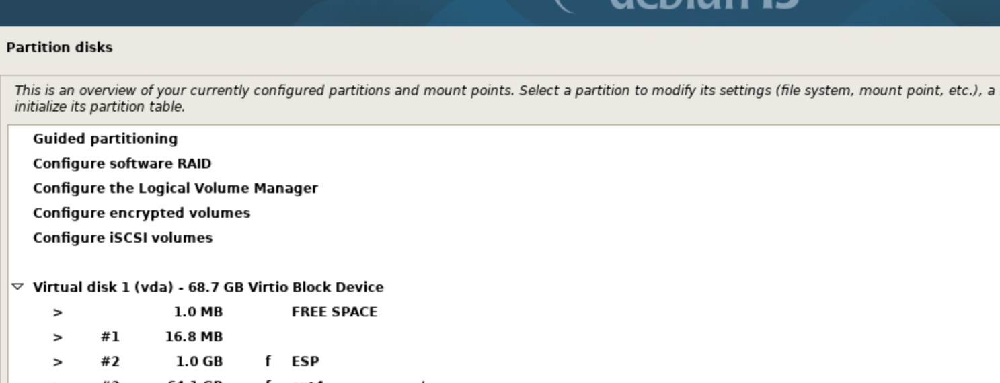
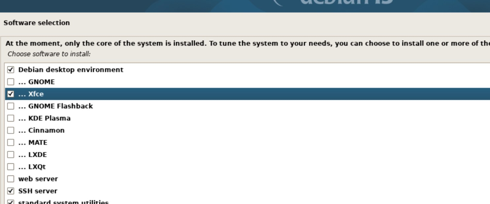
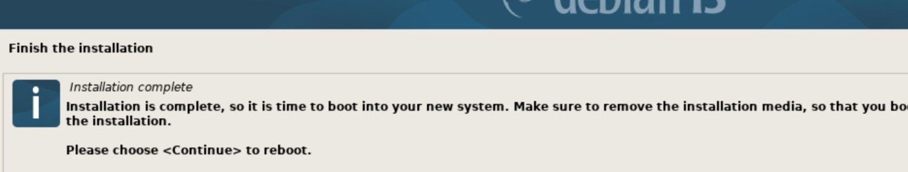
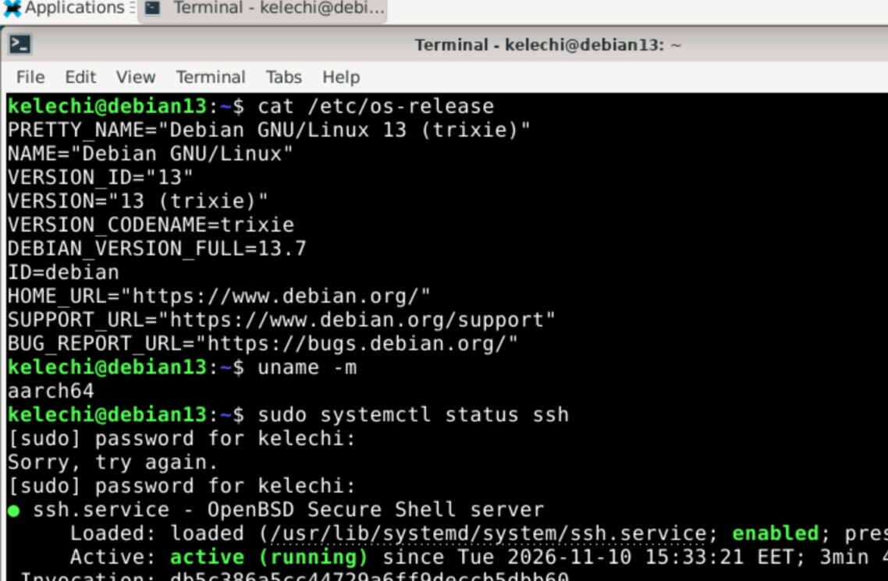
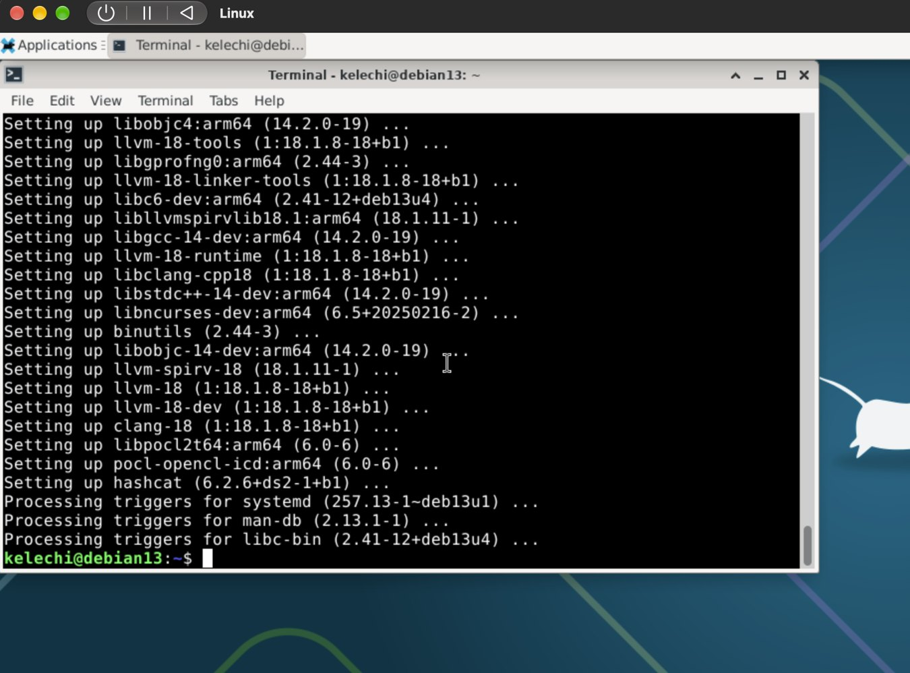
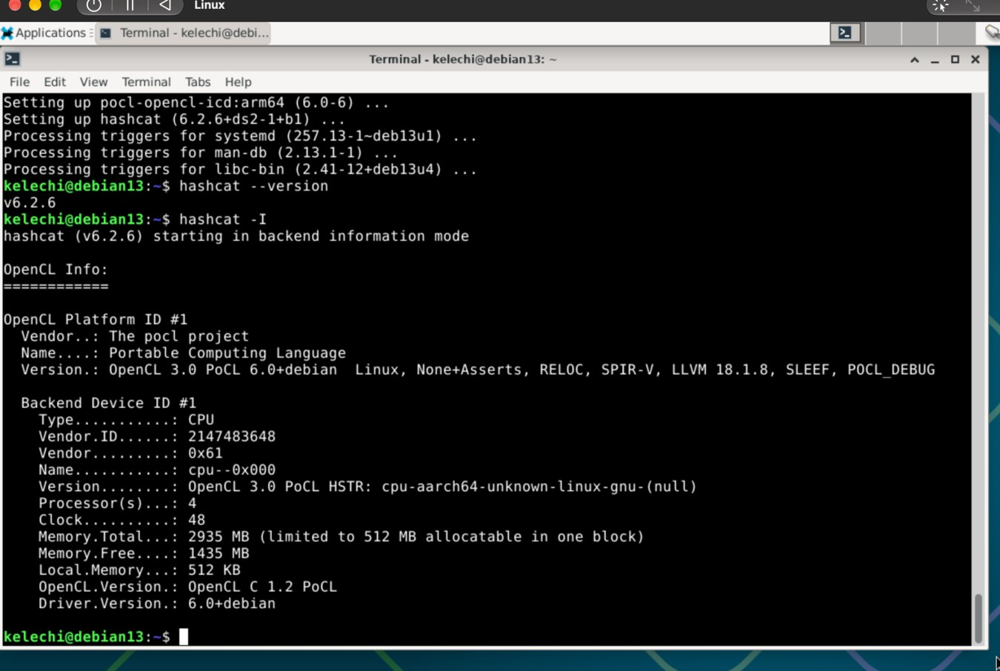
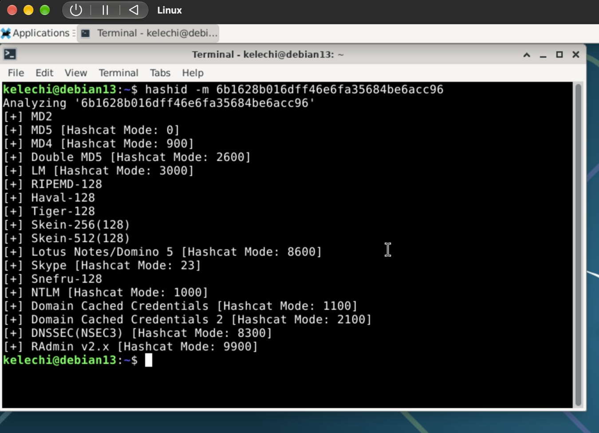
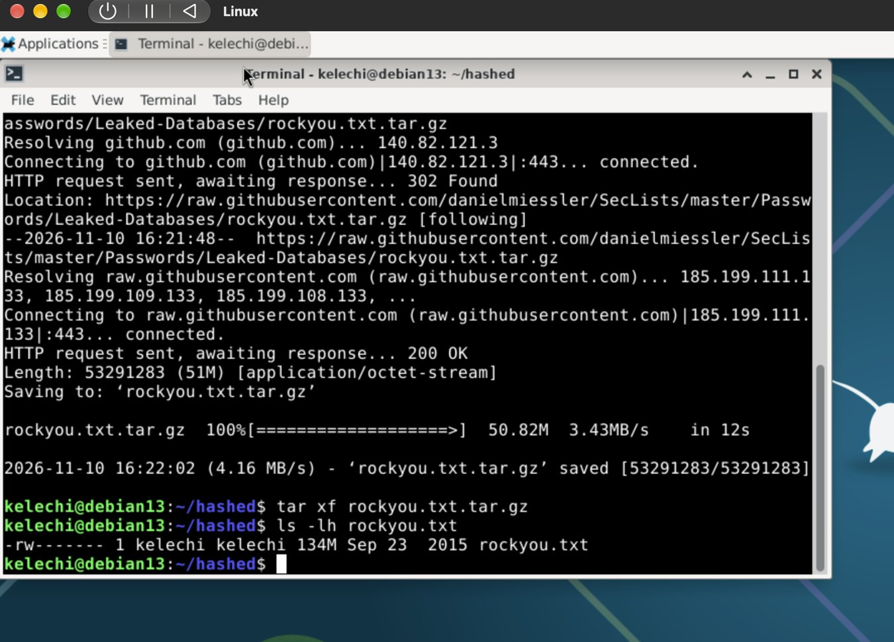
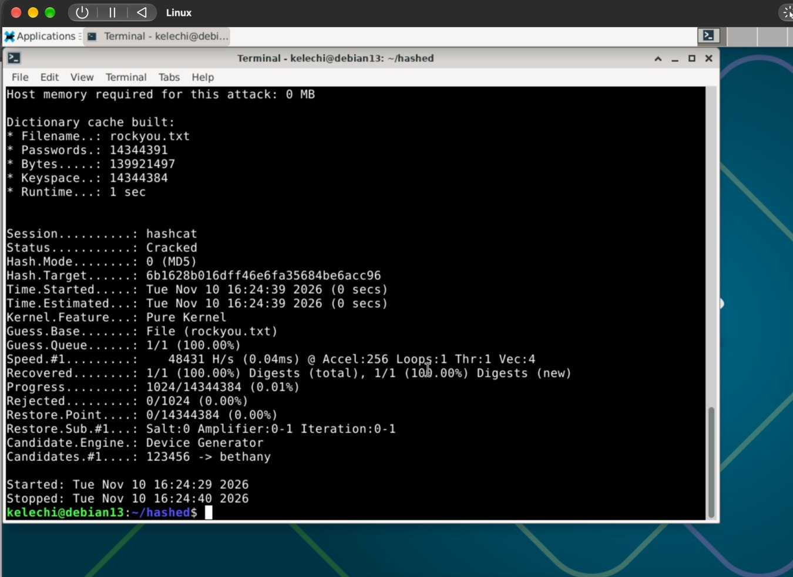

## (a) Reading Summaries

### 1. Heinonen (2026): How to Install Linux to VirtualBox?

- Explains how to install Debian Linux using VirtualBox without affecting the host operating system.
- Covers downloading Debian, creating a virtual machine, allocating resources, and installing Linux.
- Recommends updating the system after installation using `sudo apt-get update` and `sudo apt-get upgrade`.
- My question: How does running Linux in VirtualBox affect performance compared to installing it directly on a computer?

Source: [Heinonen (2026)](https://github.com/johannaheinonen/johanna-test-repo/blob/main/module_1.md?)

### 2. Karvinen (2020): Command Line Basics Revisited

- Introduces essential Linux commands for navigating directories and managing files.
- Explains commands such as `ls`, `cd`, `pwd`, `mkdir`, `cp`, `mv`, and `rm`.
- Covers remote connections using SSH, software installation, and accessing command documentation.
- My observation: Linux command-line skills are valuable for system administration, troubleshooting, and automation.

Source: [Karvinen (2020)](https://terokarvinen.com/2020/command-line-basics-revisited)

### 3. Karvinen (2022): Cracking Passwords with Hashcat

- Introduces Hashcat as a tool for recovering passwords from hashes.
- Demonstrates dictionary attacks using the RockYou password list.
- Explains how to identify hash types and use Hashcat to test password candidates.
- My observation: Weak and commonly used passwords are vulnerable to dictionary attacks, highlighting the importance of strong passwords.

Source: [Karvinen (2022)](https://terokarvinen.com/2022/cracking-passwords-with-hashcat)


## (b) Debian 13 (Trixie) Installation on UTM

**Date:** 10 November 2026  
**Platform:** Apple MacBook M4  
**Virtualization software:** UTM (QEMU, ARM64 virtualization)

## Objective

Install Debian 13 (Trixie) Linux in a virtual machine for the Linux coursework and verify that the system boots and functions correctly.

## Virtual machine configuration

| Component | Configuration |
|---|---|
| Linux distribution | Debian GNU/Linux 13 (Trixie), release 13.7 |
| Installation image | `debian-13.7.0-arm64-netinst.iso` |
| Architecture | ARM64 (`aarch64`) |
| Virtual machine | UTM / QEMU ARM Virtual Machine |
| Memory | 4 GB |
| CPU | 4 cores |
| Virtual storage | 64 GiB |
| Networking | Shared Network (NAT) |
| Desktop environment | Xfce |
| Remote access | OpenSSH server |



*Figure 1. UTM configuration showing the ARM64 VM and Debian installer ISO.*

## Installation procedure

1. **Downloaded the installer:** Obtained the Debian 13 (Trixie) ARM64 network-installation ISO from the [official Debian website](https://www.debian.org/releases/trixie/debian-installer/).
2. **Created the VM:** In UTM, selected **Create a New Virtual Machine → Virtualize → Linux**, attached the ISO, configured 4 GB RAM and 4 CPU cores, and allocated a 64 GiB virtual disk.
3. **Started Debian installation:** Booted the VM from the ISO and selected **Graphical install**.
4. **Configured the system:** Selected English, Finland, an English UTF-8 locale, and an appropriate keyboard layout. Set hostname `debian13` and created a standard user account with `sudo` privileges.
5. **Partitioned the virtual disk:** Chose **Guided – use entire disk** on the 68.7 GB Virtio disk (`vda`, equivalent to 64 GiB). The installer configured an EFI System Partition, an ext4 root partition, and swap.



*Figure 2. Guided partition layout on the virtual disk.*

6. **Configured package repositories:** Selected `deb.debian.org` as the package mirror, left the HTTP proxy empty, and declined the optional package-usage survey.
7. **Selected software:** Enabled **Debian desktop environment**, **Xfce**, **SSH server**, and **standard system utilities**.



*Figure 3. Selected software packages and services.*

8. **Completed installation:** After Debian reported success, rebooted the VM. The installer initially reappeared because the ISO was still attached; I stopped the VM, ejected the ISO from UTM's CD/DVD drive, and restarted successfully from the virtual disk.



*Figure 4. Installation-complete screen.*

## Verification

After logging into the Xfce desktop, I ran:

```bash
cat /etc/os-release
uname -m
sudo systemctl status ssh
```

The results confirmed:

- **OS:** Debian GNU/Linux 13 (Trixie), full release **13.7**
- **Architecture:** `aarch64`
- **SSH:** `active (running)` and `enabled`



*Figure 5. Terminal verification of Debian version, architecture, and SSH service.*

I also checked package repository connectivity using `sudo apt update`; APT reported that the installed packages were up to date.

## Outcome

**Completed successfully.** Debian 13 (Trixie) runs in a UTM virtual machine on the MacBook M4. The Xfce desktop, ARM64 architecture, and SSH service were verified. A VM backup was also created for future coursework; restoration from the backup has not been tested.

## References

- [Debian 13 (Trixie) documentation](https://www.debian.org/releases/trixie/)
- [UTM documentation](https://docs.getutm.app/)


## (c) Cracking a Password Hash with Hashcat

**Objective:** Crack the provided example hash `6b1628b016dff46e6fa35684be6acc96` by following Karvinen's Hashcat tutorial.

**Environment:** Debian 13.7 (Trixie), ARM64, Xfce, running in UTM on a MacBook M4.

### 1. Install the tools

I refreshed the package list and installed Hashid, Hashcat, and Wget:

```bash
sudo apt-get update
sudo apt-get -y install hashid hashcat wget
```

The installation also included PoCL, which provided an OpenCL CPU backend. `hashcat --version` reported **v6.2.6**, and `hashcat -I` detected a **4-processor CPU device**.





### 2. Identify the hash

I analysed the supplied hash:

```bash
hashid -m 6b1628b016dff46e6fa35684be6acc96
```

Hashid listed several possible types, including **MD5 (Hashcat mode 0)**. I used MD5 as specified for the course example; the hash format alone does not establish the algorithm.



### 3. Download the wordlist

I downloaded and extracted the RockYou password dictionary in `~/hashed`:

```bash
mkdir -p ~/hashed
cd ~/hashed
wget https://github.com/danielmiessler/SecLists/raw/master/Passwords/Leaked-Databases/rockyou.txt.tar.gz
tar xf rockyou.txt.tar.gz
ls -lh rockyou.txt
```

The extracted `rockyou.txt` file was approximately **134 MB**.



### 4. Run the dictionary attack

I ran Hashcat with **MD5 (`-m 0`)** and **dictionary mode (`-a 0`)**:

```bash
hashcat -m 0 -a 0 '6b1628b016dff46e6fa35684be6acc96' rockyou.txt -o solved
```

Hashcat reported **`Status: Cracked`** and **`Recovered: 1/1 (100%)`**, confirming successful recovery of the example hash. The screenshot documents the result; the plaintext output was not captured separately.



### Conclusion

I successfully completed the example MD5 dictionary attack with Hashcat using CPU-based OpenCL in Debian 13. This exercise demonstrates why weak passwords and fast, unsalted password hashes are vulnerable to dictionary attacks.

**Reference:** [Karvinen (2022), *Cracking Passwords with Hashcat*](https://terokarvinen.com/2022/cracking-passwords-with-hashcat/).
