## x) Why Use a Feed Reader (RSS/Atom)?

An RSS/Atom reader collects updates from multiple websites into one interface. Instead of visiting each cybersecurity website individually, I can subscribe to their feeds and access recent articles in one place.

**Benefits:**
- Saves time by centralising information.
- Makes it easier to monitor multiple cybersecurity sources.
- Displays updates in chronological order.
- Reduces distractions compared with social media.

**Limitations:**
- Some feeds provide only article summaries.
- Following many feeds can cause information overload.
- Not all websites offer RSS/Atom feeds.
- Important security information still requires verification.

**Conclusion:** Feed readers provide an efficient way to follow cybersecurity developments without repeatedly visiting individual websites.

**Source:** [Thunderbird RSS Documentation](https://support.mozilla.org/en-US/kb/how-subscribe-news-feeds-and-blogs)

---

## y) Finnish Supreme Court Case KKO:2003:36

The Finnish Supreme Court examined a case involving the port scanning of Osuuspankkikeskus's computer systems.

**Key findings:**

- The defendant scanned the organisation's network to identify open proxy services.
- The scanning did not bypass the organisation's firewall.
- The Supreme Court considered the conduct, given the established intent and circumstances, to constitute attempted unauthorised access.

**My observation:**

Port scanning can be useful for legitimate security assessments, but permission and purpose are essential. Scanning systems without authorisation may have legal consequences.


**Source:** [Finlex – KKO:2003:36](https://www.finlex.fi/fi/oikeuskaytanto/korkein-oikeus/ennakkopaatokset/2003/36)

---

## a) Installing a Feed Reader

I installed Mozilla Thunderbird inside my Debian 13 virtual machine using the terminal.

```bash
sudo apt-get update
sudo apt-get -y install thunderbird
```

After installation, I launched Thunderbird:

```bash
thunderbird
```

I skipped the email configuration because the assignment only required an RSS/Atom feed reader.

I then created a new feed account named **Cybersecurity Feeds**.

### Screenshots

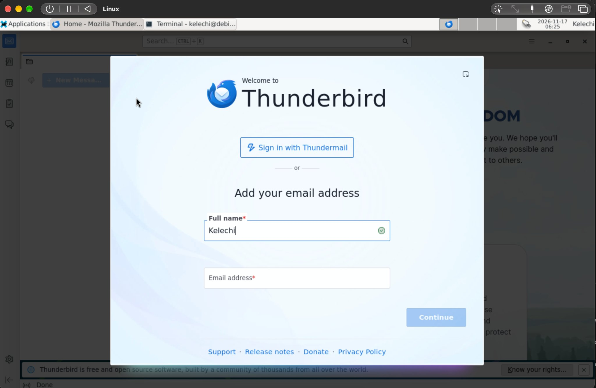

*Figure 1: Thunderbird running inside Debian 13.*


*Figure 2: Configuring an RSS subscription in Thunderbird.*

**Result:** Thunderbird was successfully installed and configured to receive RSS/Atom feeds.

---

## b) Krebs on Security Feed

I subscribed to Krebs on Security using the following RSS URL:

https://krebsonsecurity.com/feed/

After adding the feed, Thunderbird successfully retrieved 10 articles.

I opened an article titled **"Who Runs the Ransomware Group Qilin?"**

The article discussed ransomware operations and the organisation of cybercriminal groups.

### Screenshot


*Figure 3: Krebs on Security articles displayed in Thunderbird.*

**Result:** The RSS subscription was successful, and articles were accessible.

---

## c) Schneier on Security Feed

I located and added the Schneier on Security Atom feed.

**Feed URL:** https://www.schneier.com/feed/atom/

Thunderbird successfully retrieved 10 articles.

I opened **"Usable Security at Luxury Hotels"**, which discussed how attackers exploited hotel reservation and refund processes.

### Screenshot

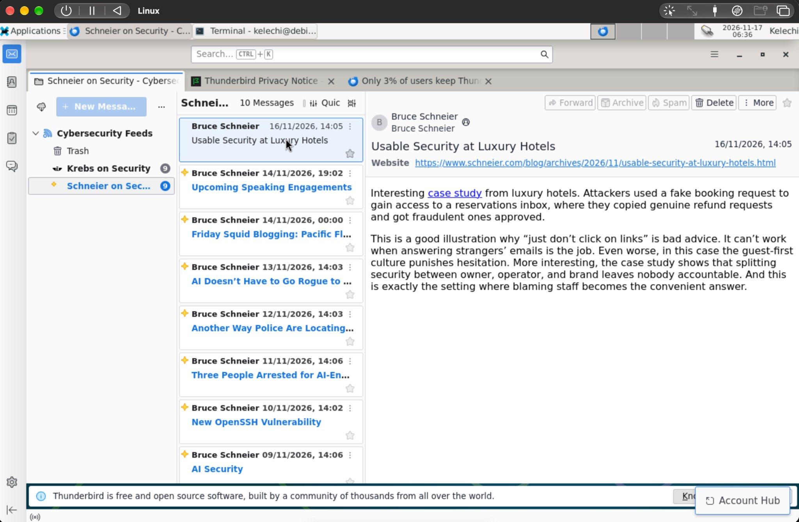

*Figure 4: Schneier on Security articles displayed in Thunderbird.*

**Result:** The Atom subscription was successful.

---

## d) Two Additional Cybersecurity Feeds

I selected two additional cybersecurity feeds:

### 1. SANS Internet Storm Center

**Feed URL:** https://isc.sans.edu/rssfeed.xml

I selected SANS because it provides technical cybersecurity information, incident reports, and network threat analysis.

### 2. CISA Cybersecurity Alerts

**Feed URL:** https://www.cisa.gov/cybersecurity-advisories/alerts.xml

I selected CISA because it publishes official security advisories and information about actively exploited vulnerabilities.

### How I Found the Feeds

I identified these feeds through their official cybersecurity websites and published RSS feed addresses.

Both feeds were successfully added to Thunderbird.

The CISA subscription displayed 30 articles. I opened **"CISA Adds Two Known Exploited Vulnerabilities to Catalog"**, published on 13 November 2026.

### Screenshot


*Figure 5: Krebs, Schneier, SANS, and CISA feeds configured in Thunderbird.*

**Result:** All four required cybersecurity feeds were successfully configured.

---

## e) Following Cybersecurity Feeds – Ongoing

I configured Thunderbird to monitor four cybersecurity sources.

### Initial Observations

**Krebs on Security:** Ransomware operations can involve organised criminal groups and affiliates.

**Schneier on Security:** Cybersecurity vulnerabilities can result from weaknesses in ordinary business workflows, not only technical software flaws.

**CISA:** The Known Exploited Vulnerabilities Catalog helps organisations identify security vulnerabilities that are being actively exploited.

**SANS Internet Storm Center:**


### Benefits of Following RSS Feeds

- Cybersecurity updates are available in one location.
- Multiple trusted sources can be monitored efficiently.
- Articles are organised by publication date.
- The reader reduces the need for repeated website visits.

### Disadvantages

- Large numbers of articles can cause information overload.
- Some feeds display only article summaries.
- Important information must still be verified through original sources.
- RSS feeds do not replace urgent security notifications.


## f) Port scanning with Nmap — completed

**Environment:** Debian 13 (Trixie), UTM on Apple Silicon. **Target:** `localhost` (`127.0.0.1`) only. **Date:** 17 November 2026.

### Preparation and network isolation

I installed Nmap and Apache2 while internet access was available:

```bash
sudo apt-get update
sudo apt-get -y install nmap apache2
```

Before scanning, I shut down the VM and removed its virtual network device in UTM. The Debian desktop then displayed **No network connection**. My ping test confirmed no route to the external IP address:

```bash
ping -c 4 8.8.8.8
# ping: connect: Network is unreachable
```

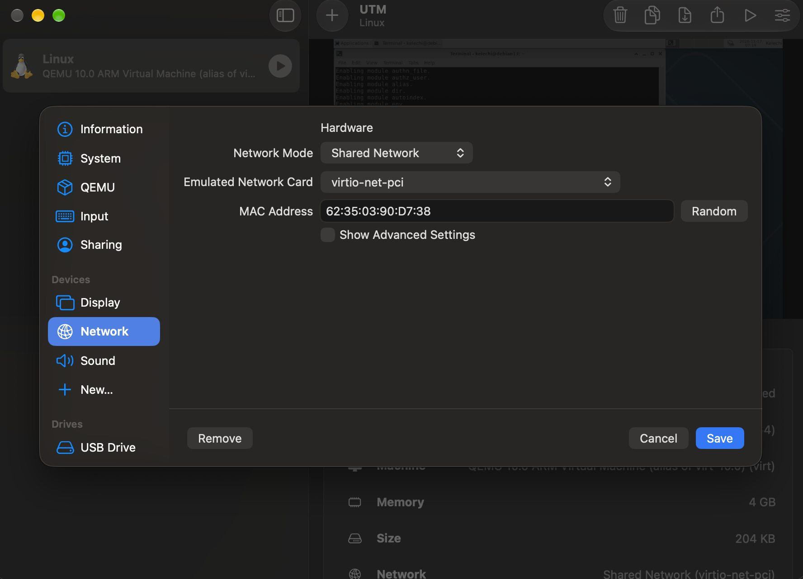

*Figure 6. UTM network settings inspected before disconnecting the VM.*

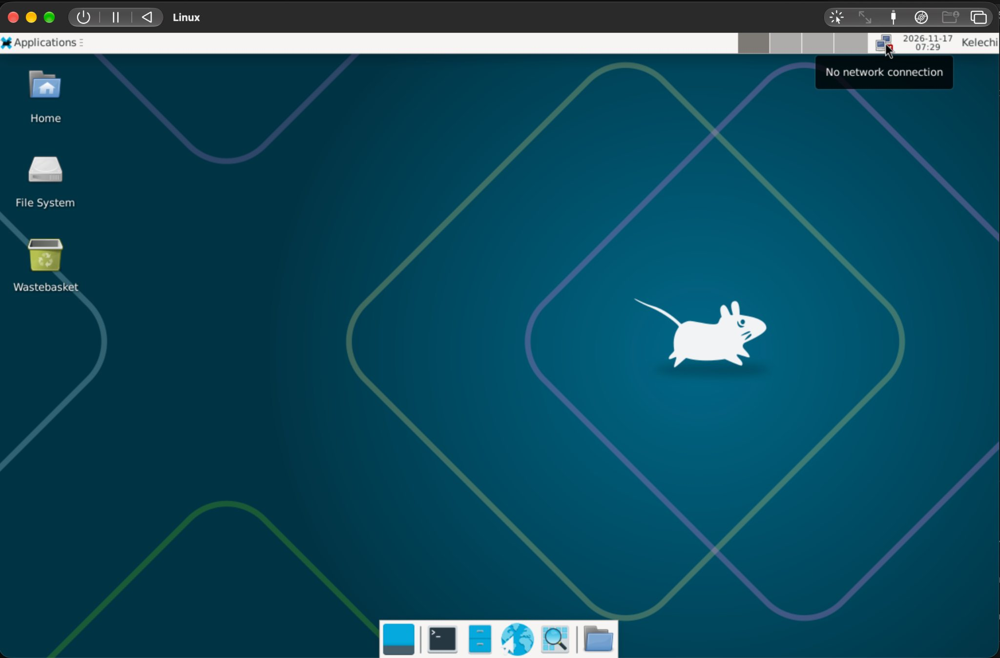

*Figure 7. Offline Debian desktop.*

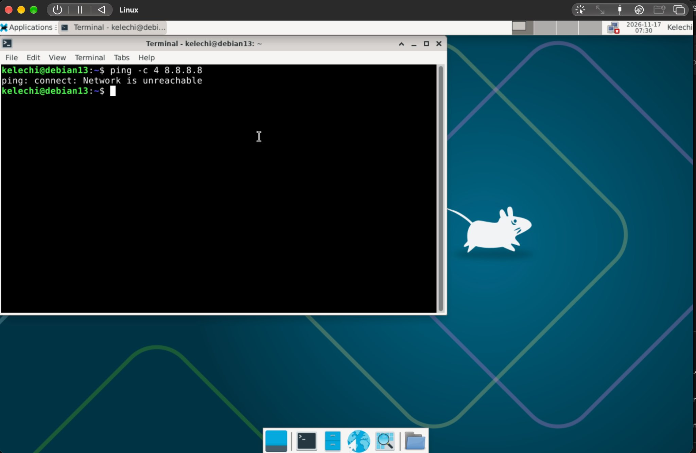

*Figure 8. The failed ping confirms the VM cannot reach the external IP address.*

### First attempt — Apache was already listening

I ran the teacher's suggested localhost scan:

```bash
sudo nmap -A -v localhost
```

The first scan, at approximately **07:35**, showed **22/tcp (SSH)**, **80/tcp (HTTP/Apache)** and **631/tcp (IPP/CUPS)** open. I subsequently ran `sudo systemctl start apache2` and scanned again, but the same three ports appeared. **This was not a valid before/after comparison**, because Apache's HTTP port was already open in the original baseline.

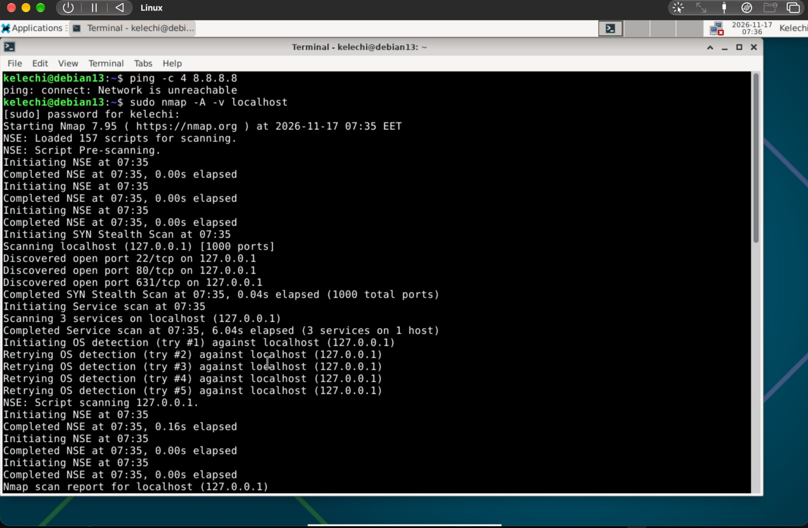

*Figure 9. Original baseline scan shows port 80 already open.*

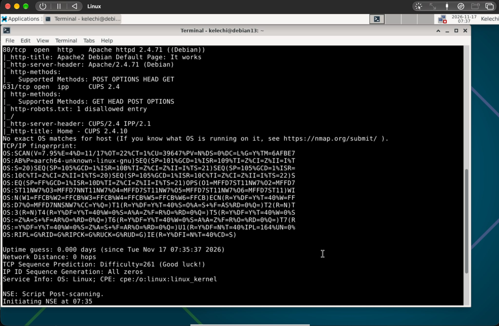

*Figure 10. Apache HTTP and CUPS services identified in the original scan.*

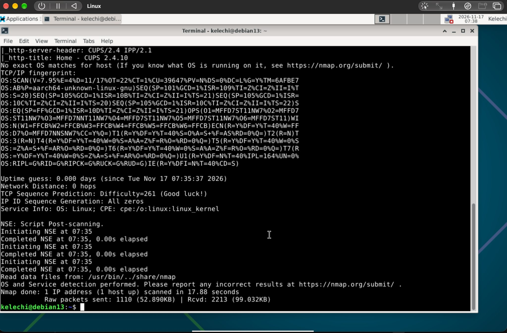

*Figure 11. Completion of the original baseline scan.*

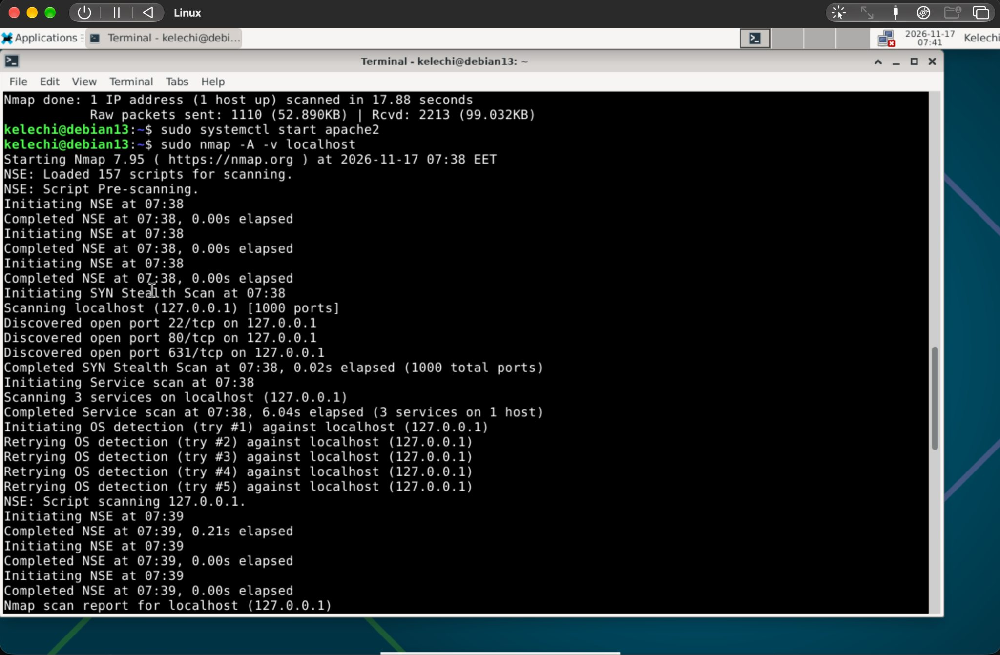

*Figure 12. Repeating Nmap after starting Apache.*

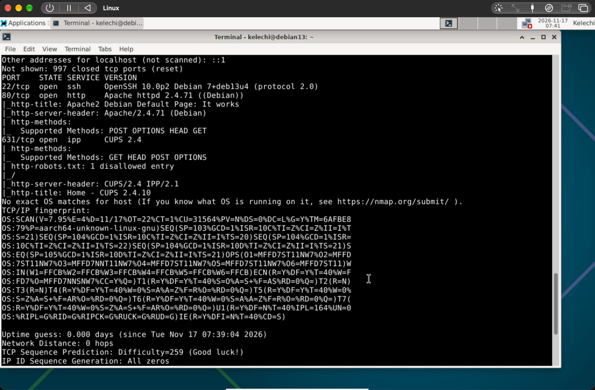

*Figure 13. The original second scan still shows ports 22, 80 and 631.*

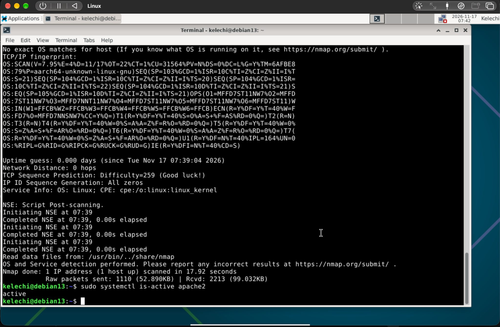

*Figure 14. Apache confirmed active after the original second scan.*

### Corrected experiment — Apache stopped, then started

I repeated the comparison after ensuring Apache was **inactive**, then scanned `localhost` again:

```bash
sudo systemctl stop apache2
sudo systemctl is-active apache2   # inactive
sudo nmap -A -v localhost
```

The corrected baseline at approximately **07:54** showed open ports **22/tcp** and **631/tcp**, but **not 80/tcp**. I then started Apache and scanned again:

```bash
sudo systemctl start apache2
sudo systemctl is-active apache2   # active
sudo nmap -A -v localhost
```

At approximately **07:56**, Nmap again detected port **80/tcp**, identifying **Apache httpd 2.4.71 (Debian)**. Ports 22 and 631 remained open.

| Port | Apache inactive | Apache active | Observed service |
|---|---|---|---|
| `22/tcp` | Open | Open | OpenSSH |
| `80/tcp` | Not open | **Open** | Apache HTTP Server 2.4.71 |
| `631/tcp` | Open | Open | CUPS / IPP |

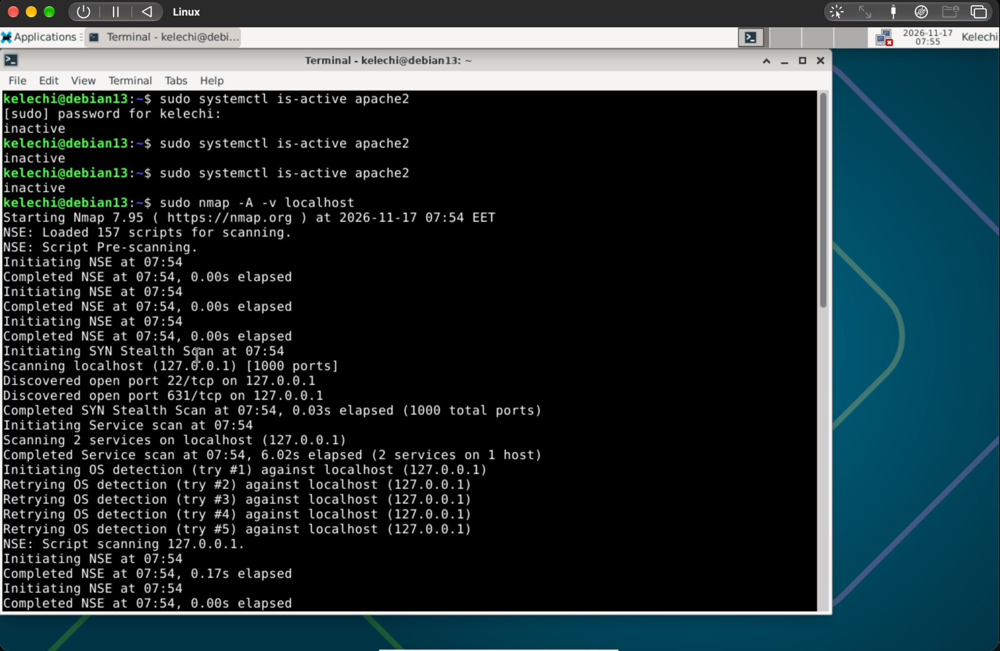

*Figure 15. Apache inactive, with only ports 22 and 631 found open.*

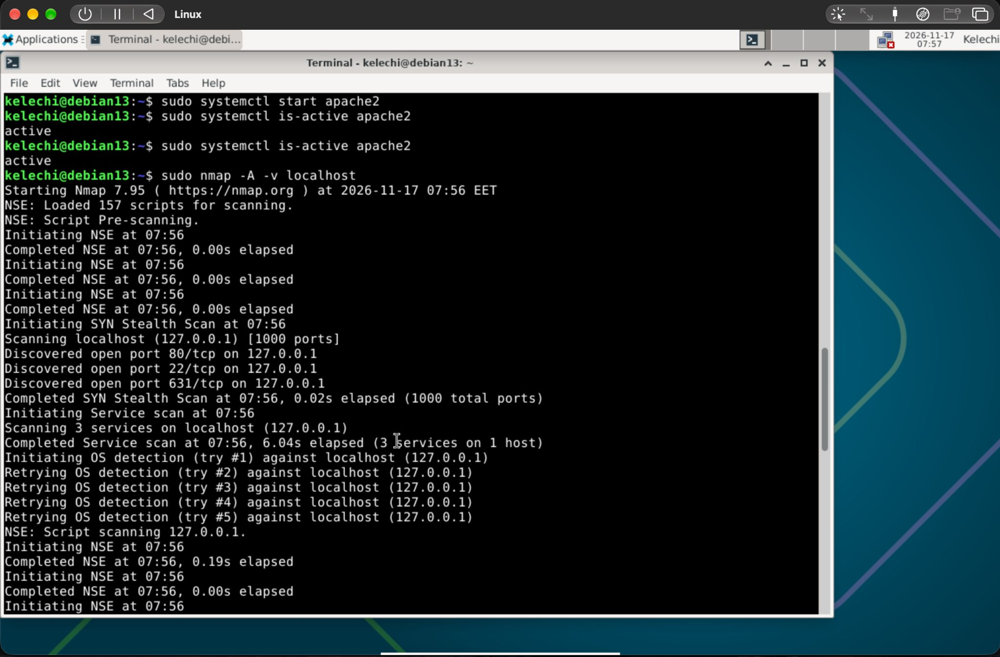

*Figure 16. Apache started and the corrected second scan begun.*

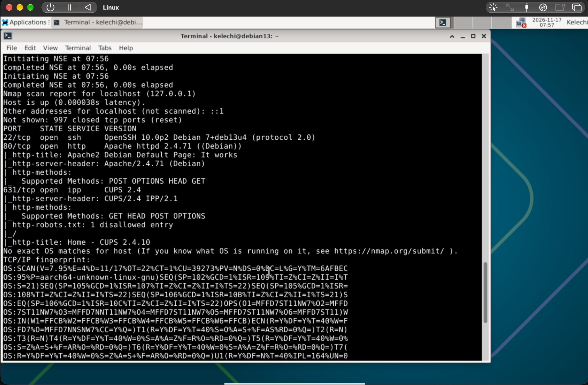

*Figure 17. Apache identified as the HTTP service on port 80.*

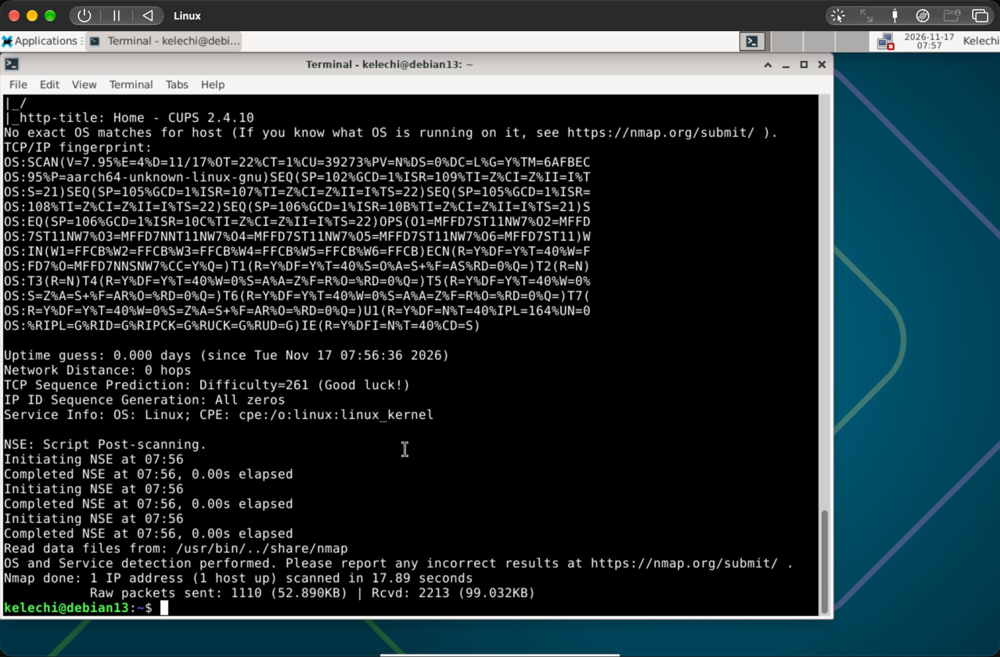

*Figure 18. Completion of the corrected second Nmap scan.*

### Analysis and conclusion

The corrected experiment demonstrated that **starting the Apache daemon made TCP port 80 available** on `localhost`. Nmap identified the open port and disclosed the web server software/version. Ports 22 (SSH) and 631 (CUPS) remained open in both scans. This helps explain how service enumeration can reveal the applications running on a reachable machine. **An open port is not by itself proof of a vulnerability.**

All scans targeted only my own VM's loopback address while the VM's network adapter was disconnected. No third-party systems were scanned.

**Task f status:** Completed.

## g–h) Optional bonus exercises

Not attempted.

## Overall status

Tasks **x, y, a, b, c, d and f** are documented. Task **e** has initial observations but requires further monitoring and a specific SANS article observation. Optional tasks **g and h** were not attempted.

## References

- [Thunderbird: Subscribe to news feeds and blogs](https://support.mozilla.org/en-US/kb/how-subscribe-news-feeds-and-blogs)
- [KKO:2003:36](https://www.finlex.fi/fi/oikeuskaytanto/korkein-oikeus/ennakkopaatokset/2003/36)
- [Nmap Reference Guide](https://nmap.org/book/man.html)
- [Krebs on Security](https://krebsonsecurity.com/)
- [Schneier on Security](https://www.schneier.com/)
- [SANS Internet Storm Center](https://isc.sans.edu/)
- [CISA](https://www.cisa.gov/)

