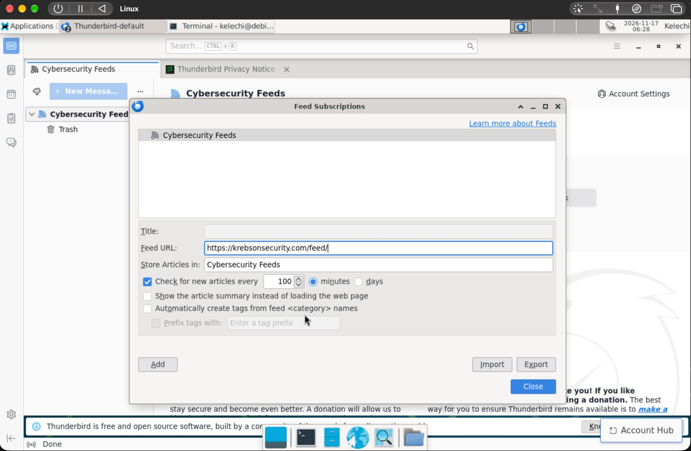
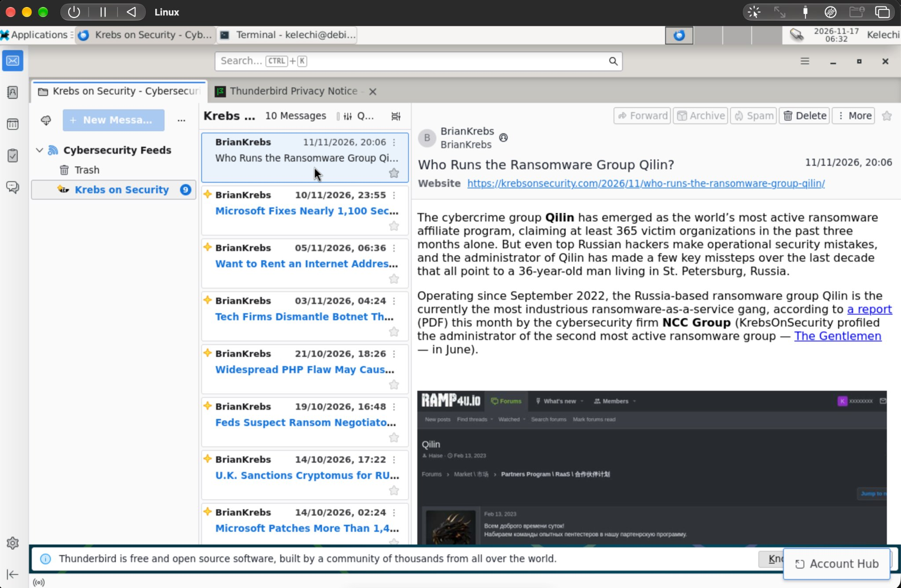
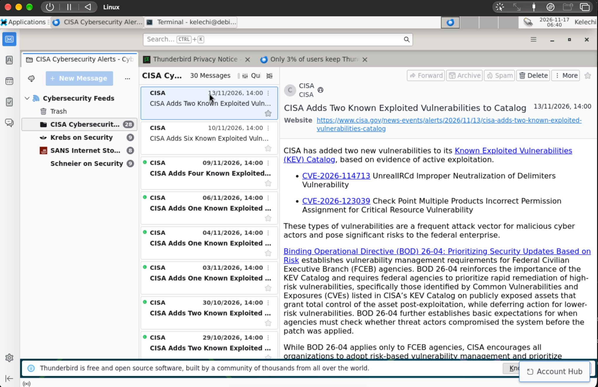

## x) Why Use a Feed Reader (RSS/Atom)?

An RSS/Atom reader collects updates from multiple websites into one interface. Instead of visiting each cybersecurity website individually, I can subscribe to their feeds and access recent articles in one place.

**Benefits:**
- Saves time by centralising information.
- Makes it easier to monitor multiple cybersecurity sources.
- Displays updates in chronological order.
- Reduces distractions compared with social media.

**Limitations:**
- Some feeds provide only article summaries.
- Following many feeds can cause information overload.
- Not all websites offer RSS/Atom feeds.
- Important security information still requires verification.

**Conclusion:** Feed readers provide an efficient way to follow cybersecurity developments without repeatedly visiting individual websites.

**Source:** [Thunderbird RSS Documentation](https://support.mozilla.org/en-US/kb/how-subscribe-news-feeds-and-blogs)

---

## y) Finnish Supreme Court Case KKO:2003:36

The Finnish Supreme Court examined a case involving the port scanning of Osuuspankkikeskus's computer systems.

**Key findings:**

- The defendant scanned the organisation's network to identify open proxy services.
- The scanning did not bypass the organisation's firewall.
- The Supreme Court considered the conduct, given the established intent and circumstances, to constitute attempted unauthorised access.

**My observation:**

Port scanning can be useful for legitimate security assessments, but permission and purpose are essential. Scanning systems without authorisation may have legal consequences.


**Source:** [Finlex – KKO:2003:36](https://www.finlex.fi/fi/oikeuskaytanto/korkein-oikeus/ennakkopaatokset/2003/36)

---

## a) Installing a Feed Reader

I installed Mozilla Thunderbird inside my Debian 13 virtual machine using the terminal.

```bash
sudo apt-get update
sudo apt-get -y install thunderbird
```

After installation, I launched Thunderbird:

```bash
thunderbird
```

I skipped the email configuration because the assignment only required an RSS/Atom feed reader.

I then created a new feed account named **Cybersecurity Feeds**.

### Screenshots


*Figure 1: Thunderbird running inside Debian 13.*



*Figure 2: Configuring an RSS subscription in Thunderbird.*

**Result:** Thunderbird was successfully installed and configured to receive RSS/Atom feeds.

---

## b) Krebs on Security Feed

I subscribed to Krebs on Security using the following RSS URL:

https://krebsonsecurity.com/feed/

After adding the feed, Thunderbird successfully retrieved 10 articles.

I opened an article titled **"Who Runs the Ransomware Group Qilin?"**

The article discussed ransomware operations and the organisation of cybercriminal groups.

### Screenshot



*Figure 3: Krebs on Security articles displayed in Thunderbird.*

**Result:** The RSS subscription was successful, and articles were accessible.

---

## c) Schneier on Security Feed

I located and added the Schneier on Security Atom feed.

**Feed URL:** https://www.schneier.com/feed/atom/

Thunderbird successfully retrieved 10 articles.

I opened **"Usable Security at Luxury Hotels"**, which discussed how attackers exploited hotel reservation and refund processes.

### Screenshot


*Figure 4: Schneier on Security articles displayed in Thunderbird.*

**Result:** The Atom subscription was successful.

---

## d) Two Additional Cybersecurity Feeds

I selected two additional cybersecurity feeds:

### 1. SANS Internet Storm Center

**Feed URL:** https://isc.sans.edu/rssfeed.xml

I selected SANS because it provides technical cybersecurity information, incident reports, and network threat analysis.

### 2. CISA Cybersecurity Alerts

**Feed URL:** https://www.cisa.gov/cybersecurity-advisories/alerts.xml

I selected CISA because it publishes official security advisories and information about actively exploited vulnerabilities.

### How I Found the Feeds

I identified these feeds through their official cybersecurity websites and published RSS feed addresses.

Both feeds were successfully added to Thunderbird.

The CISA subscription displayed 30 articles. I opened **"CISA Adds Two Known Exploited Vulnerabilities to Catalog"**, published on 13 November 2026.

### Screenshot



*Figure 5: Krebs, Schneier, SANS, and CISA feeds configured in Thunderbird.*

**Result:** All four required cybersecurity feeds were successfully configured.

---

## e) Following Cybersecurity Feeds – Ongoing

I configured Thunderbird to monitor four cybersecurity sources.

### Initial Observations

**Krebs on Security:** Ransomware operations can involve organised criminal groups and affiliates.

**Schneier on Security:** Cybersecurity vulnerabilities can result from weaknesses in ordinary business workflows, not only technical software flaws.

**CISA:** The Known Exploited Vulnerabilities Catalog helps organisations identify security vulnerabilities that are being actively exploited.

**SANS Internet Storm Center:**


### Benefits of Following RSS Feeds

- Cybersecurity updates are available in one location.
- Multiple trusted sources can be monitored efficiently.
- Articles are organised by publication date.
- The reader reduces the need for repeated website visits.

### Disadvantages

- Large numbers of articles can cause information overload.
- Some feeds display only article summaries.
- Important information must still be verified through original sources.
- RSS feeds do not replace urgent security notifications.


