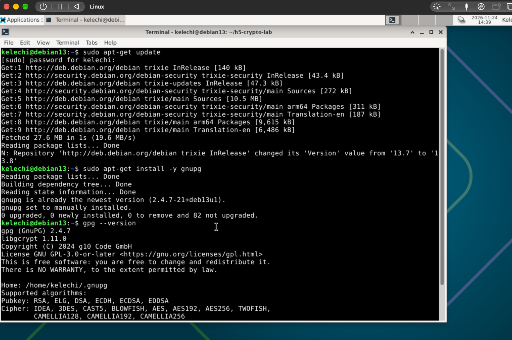
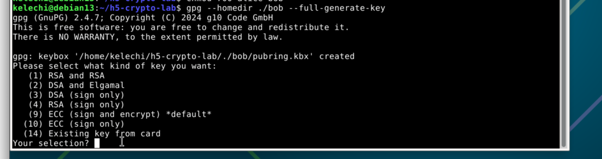
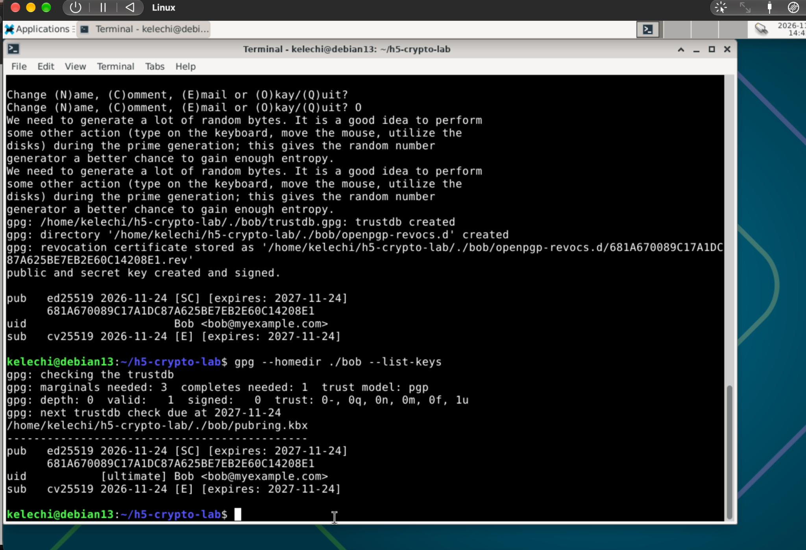
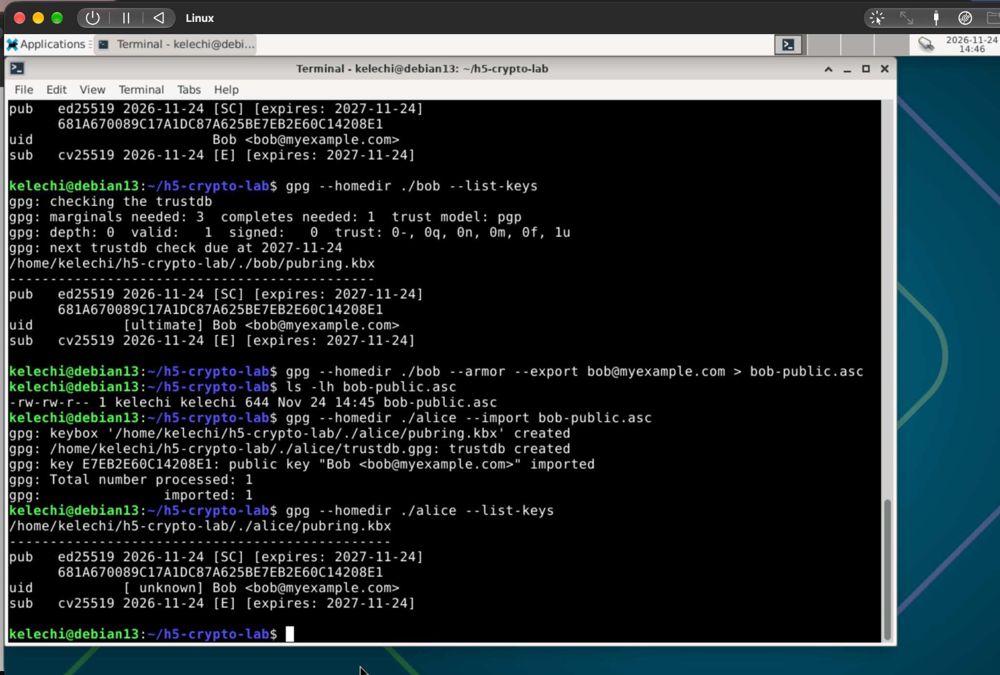
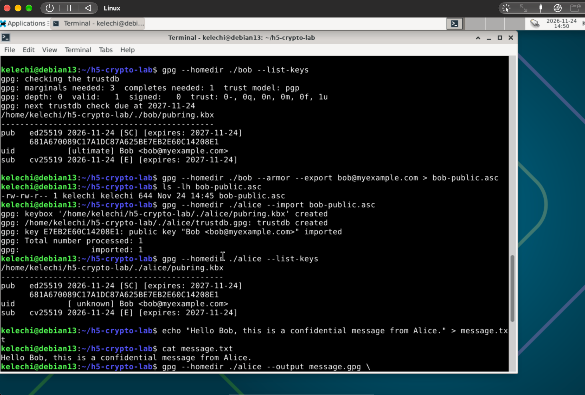
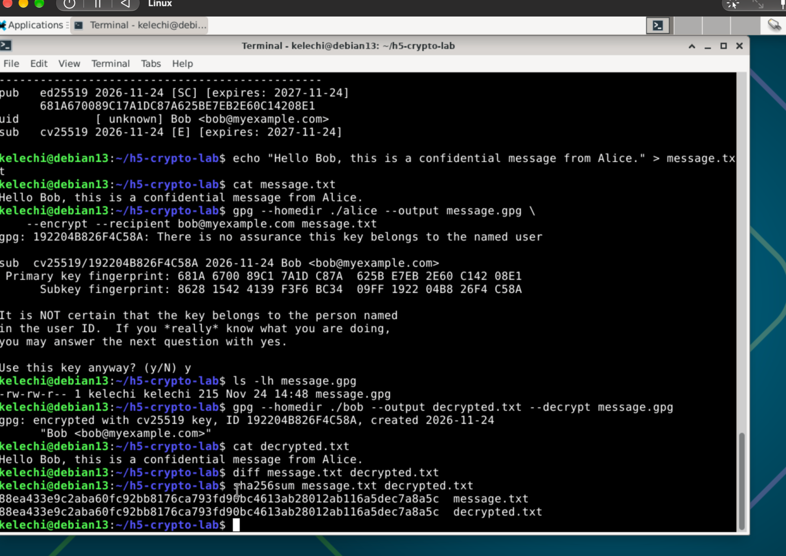

## x) Reading Summaries

### 1. Schneier (2015): *Applied Cryptography*

#### Chapter 1 – Foundations, Section 1.1: Terminology

- **Sender and receiver:** Cryptography enables two parties to communicate securely while preventing unauthorised parties from reading their messages.
- **Plaintext and ciphertext:** Plaintext is the original message. Encryption transforms it into ciphertext; decryption recovers the plaintext.
- **Cryptographic algorithms and keys:** An algorithm defines the encryption and decryption operations, while a key controls them. Security should depend on protecting the key rather than concealing the algorithm.
- **Symmetric algorithms:** Sender and receiver use the same secret key, or keys that can be derived from each other. They must agree on the key securely.
- **Public-key algorithms:** Different keys are used for encryption and decryption. Anyone can encrypt a message using the recipient's public key, but the corresponding private key is required to decrypt it.
- **Other security objectives:** Cryptography can also support authentication, integrity and nonrepudiation.

#### Chapter 2 – Protocol Building Blocks, Section 2.5: Communications Using Public-Key Cryptography

- Public-key cryptography allows Alice to send Bob an encrypted message without first sharing a secret key.
- Bob makes his public key available; Alice encrypts her message using it; Bob decrypts the ciphertext using his private key.
- An eavesdropper such as Eve may see the public key and encrypted message but should not be able to recover the plaintext without Bob's private key.
- Public-key algorithms are generally slower than symmetric encryption, so practical **hybrid cryptosystems** use public-key methods to protect a session key and symmetric methods to encrypt the communication.
- Session keys can be generated when needed and discarded afterwards, reducing the time they must be protected.
- **Merkle's puzzles** illustrate an early way to establish a secret over an insecure channel by making an eavesdropper perform significantly more work than the legitimate participants.

#### My Observation

Public-key cryptography addresses the difficulty of distributing shared secret keys. Combining asymmetric key establishment with efficient symmetric encryption makes secure communication more practical.


### 2. Karvinen (2023): PGP – Send Encrypted and Signed Message – gpg

- **GPG and PGP:** The tutorial demonstrates using the `gpg` command-line tool to exchange an encrypted and digitally signed message over an untrusted network.
- **Key pairs:** Each participant generates a public key and a private (secret) key. Public keys can be shared, but private keys must remain protected.
- **Key exchange and trust:** Alice and the recipient exchange public keys, import them into their keyrings, and verify their fingerprints to confirm they belong to the intended people.
- **Separate identities:** The tutorial simulates two participants using different GPG keyrings; `gpg --homedir .` keeps Alice's keyring separate.
- **Encryption:** Alice encrypts the message using the recipient's **public key** (`--encrypt --recipient`). Only the matching private key can decrypt it.
- **Digital signatures:** Alice signs using her **private key** (`--sign`). The recipient checks the signature using Alice's public key, helping establish authenticity and detect modification.
- **Message exchange:** The tutorial uses `--armor` to produce transferable ASCII-formatted encrypted output and `gpg --decrypt` to recover the message and check its signature.
- **Security takeaway:** Encryption protects message confidentiality, while a verified digital signature supports authenticity and integrity. Verifying public-key fingerprints is important because obtaining a key alone does not prove its owner's identity.

**My observation:** I learned that secure PGP communication requires both the correct use of public/private keys and verification of whose public keys are being used. Signing and encryption serve different purposes and can be combined in one message.

**Source:** 
- Schneier, B. (2015). *Applied Cryptography: Protocols, Algorithms, and Source Code in C* (20th Anniversary Edition). [O'Reilly Learning](https://learning.oreilly.com/library/view/applied-cryptography-protocols/9781119096726/).
- Karvinen, T. (2023). [*PGP – Send Encrypted and Signed Message – gpg*](https://terokarvinen.com/2023/pgp-encrypt-sign-verify/).


### a) Public-Key Cryptography Today

**Example: Using GitHub with HTTPS**

I used public-key cryptography when accessing GitHub through my web browser to work on my cybersecurity assignments.

GitHub uses HTTPS to keep communication between my browser and its servers secure.

**How it works:**

1. **Connecting:** When I open GitHub, my browser connects to GitHub's server using HTTPS.
2. **Public key:** GitHub sends my browser a security certificate containing its public key. My browser checks that the certificate is trustworthy.
3. **Private key:** GitHub uses its private key to help prove that I am communicating with the genuine server.
4. **Creating a shared secret:** My browser and GitHub exchange information using temporary public and private keys to establish a shared secret.
5. **Secure communication:** Both sides use the shared secret to create symmetric encryption keys. These keys protect the information exchanged between my browser and GitHub.

**What I learned:**

Public-key cryptography allows my browser to establish a secure connection with GitHub without sending a shared encryption secret across the internet in plain text.

I also learned that public-key cryptography and symmetric encryption work together: public-key cryptography helps establish trust and shared secrets, while symmetric encryption protects the actual communication.

GitHub – Authentication Documentation

**Sources:**

- [RFC 8446 – TLS 1.3](https://www.rfc-editor.org/rfc/rfc8446)
- [Cloudflare – How HTTPS Works](https://www.cloudflare.com/learning/ssl/what-is-https/)
- [GitHub – Authentication Documentation](https://docs.github.com/en/authentication)


## b) Encrypt and Decrypt a Message with GPG

**Date:** 24 November 2026  
**Environment:** Debian GNU/Linux 13 (Trixie), ARM64, UTM virtual machine  
**Tool:** GnuPG (GPG) 2.4.7

### Objective

I used GPG to demonstrate public-key encryption by simulating two people: Alice (sender) and Bob (recipient). The goal was to encrypt a message using Bob's **public key**, decrypt it using Bob's **private key**, and verify that the original and recovered messages matched.

### 1. Verify GPG and prepare the working folders

GPG was already installed. I checked its version and prepared separate GPG home directories to simulate Alice and Bob.

```bash
sudo apt-get update
sudo apt-get install -y gnupg
gpg --version
mkdir -p ~/h5-crypto-lab/{alice,bob}
chmod 700 ~/h5-crypto-lab/{alice,bob}
cd ~/h5-crypto-lab
```



*Figure 1: GPG 2.4.7 was available in Debian.*

### 2. Generate Bob's key pair

I ran:

```bash
gpg --homedir ./bob --full-generate-key
```

I selected **ECC (sign and encrypt)** with Ed25519 signing and Curve25519 encryption keys, set a one-year expiry, and used the lab identity `Bob <bob@myexample.com>`. I protected the private key with a passphrase.



*Figure 2: Selecting ECC for key generation.*

```bash
gpg --homedir ./bob --list-keys
```



*Figure 3: Bob's public key and encryption subkey were created successfully.*

### 3. Share Bob's public key with Alice

I exported only Bob's public key and imported it into Alice's separate GPG keyring.

```bash
gpg --homedir ./bob --armor --export bob@myexample.com > bob-public.asc
ls -lh bob-public.asc
gpg --homedir ./alice --import bob-public.asc
gpg --homedir ./alice --list-keys
```



*Figure 4: Alice successfully imported Bob's public key. GPG marked its identity as unverified (`unknown`).*

### 4. Create and encrypt Alice's message

I created a simple plaintext message:

```bash
echo "Hello Bob, this is a confidential message from Alice." > message.txt
cat message.txt
```



*Figure 5: Original plaintext and the beginning of the encryption operation.*

Alice encrypted it for Bob using the public key in her keyring:

```bash
gpg --homedir ./alice --output message.gpg \
  --encrypt --recipient bob@myexample.com message.txt
ls -lh message.gpg
```

GPG warned that the imported key's owner had not been independently verified. I proceeded because this was a controlled exercise using the key generated in Bob's lab directory. In real communication, I should verify the recipient's key fingerprint through a trusted channel before relying on it.

### 5. Decrypt as Bob and verify the result

Bob decrypted the file using the private key in his own keyring:

```bash
gpg --homedir ./bob --output decrypted.txt --decrypt message.gpg
cat decrypted.txt
diff message.txt decrypted.txt
sha256sum message.txt decrypted.txt
```

The decrypted message was:

```text
Hello Bob, this is a confidential message from Alice.
```

The `diff` command returned no differences, and both files had **matching SHA-256 hashes**. This confirmed that the recovered file matched the original plaintext.



*Figure 6: Successful encryption, decryption, file comparison, and matching SHA-256 checksums.*

### How the keys were used

| Stage | Party | Key and purpose |
|---|---|---|
| Key generation | Bob | Creates a public/private key pair |
| Key sharing | Bob → Alice | Shares **public** key only |
| Encryption | Alice | Encrypts for Bob using **Bob's public key** |
| Decryption | Bob | Decrypts using **Bob's private key** |
| Verification of recovered text | Lab comparison | `diff` and SHA-256 confirm file equality (not sender identity) |

GPG uses hybrid encryption: it encrypts the message using a symmetric session key and protects that session key with the recipient's public-key encryption mechanism.

### Security evaluation

**Strengths:** GPG offers encryption using established algorithms and keeps private keys separate from public keys. It also supports digital signatures, although signing was **not** performed in this task.

**Limitations:** An incorrect or impersonated public key can compromise confidentiality. Private keys and passphrases must be protected. In this exercise, Alice and Bob were simulated using two folders under one Linux account; this demonstrates the key operations but is **not** the same security isolation as two separate real users or computers. Matching file hashes prove that decryption reproduced the original data, **not** that Alice authenticated or signed the message.

### Conclusion

I successfully encrypted a plaintext message with Bob's public key and decrypted it with Bob's private key. The decrypted text matched the original. The exercise demonstrated confidentiality and the importance of public-key verification; digital signatures and sender authentication are separate operations.

### Sources

- [Tero Karvinen (2023): PGP – Send Encrypted and Signed Message – gpg](https://terokarvinen.com/2023/pgp-encrypt-sign-verify/)
- [GnuPG official manual](https://www.gnupg.org/documentation/manuals/gnupg/)
- [h5 – Alice and Bob assignment](https://terokarvinen.com/cyber-security/)


